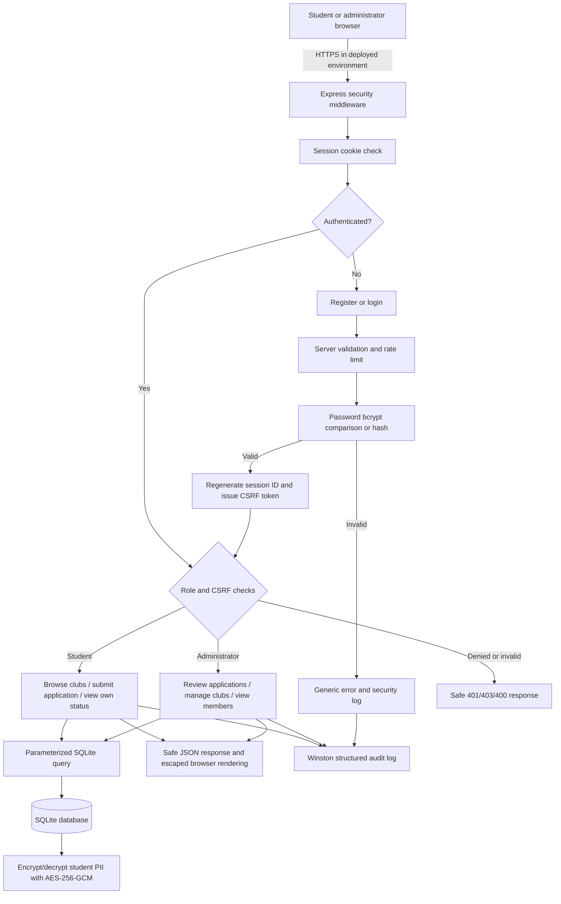

# ELE201 — Secure Student Club Registration and Membership Management System

A web application for students to discover campus clubs, apply for membership, and track decisions. Club administrators can review requests, approve or reject them, maintain club information, and view approved members. The implementation follows the supplied ELE201 proposal and demonstrates practical secure coding controls.

## Features

### Student workspace

- Student account registration using name, student ID, institutional email, and a strong password.
- Secure login and logout; authenticated session cookies are `HttpOnly`, `SameSite=Strict`, and `Secure` when HTTPS is configured.
- Browse club descriptions, categories, and application choices.
- Submit one application per club and see pending, approved, or rejected status.
- Student identity fields are encrypted at rest; students can only access their own application records.

### Club administrator workspace

- A seeded administrator account is created from environment configuration on first startup.
- Review queued applications, see the student record needed for the decision, and approve or reject pending requests.
- Create and edit club information, set member capacity, and review the approved members list. Approval is blocked when a club has reached its configured capacity.
- All administrator routes enforce the `admin` role on the server. Hiding admin controls in the browser is not treated as authorization.

### Security controls

| Proposal area | Implementation in this project |
| --- | --- |
| Authentication and authorization | bcrypt password hashes (cost 12), session regeneration after login, server-side role checks, least-privilege student/admin routes, login and registration rate limits. |
| Data protection | AES-256-GCM encryption of name, email, and student ID at rest; keyed HMAC email lookup index; keys and initial admin credentials are environment values. SQLite parameter binding is used for SQL values. |
| Validation and XSS / SQLi defense | Zod schemas validate and bound server-side request values; parameterized SQL; browser renders untrusted text through HTML escaping; Content Security Policy restricts script sources. |
| Session management | SQLite-backed sessions, 30-minute rolling idle expiry, random session ID regeneration at authentication, CSRF token for state-changing requests, logout invalidation, `HttpOnly`/`SameSite=Strict` and conditional `Secure` cookie flags. |
| Error handling and audit logs | Central safe JSON error handler; structured Winston security log records login outcomes and important membership/admin actions. User responses omit stack traces and SQL errors. |
| Secure communication | Direct HTTPS can be enabled with TLS key/certificate paths. Production may terminate TLS at a trusted reverse proxy; configure that proxy and its Express trust setting before deployment. |
| Security testing and audit | Manual verification checklist and evidence plan are in [SECURITY.md](SECURITY.md). Do not use the sample local setup as a production deployment. |

## Cyber flow



### Request and data sequence

1. On load, the browser asks for a session-bound CSRF token. Registration, login, applications, reviews, and club changes send that token on every state-changing request.
2. Registration input is validated on the server. The password is bcrypt-hashed; name, email, and student ID are encrypted with AES-256-GCM before SQLite storage. A keyed HMAC of normalized email supports account lookup without storing it in clear text.
3. Login normalizes and validates the email, uses the HMAC to locate the account, and compares the submitted password with bcrypt. The response is intentionally generic for unknown emails and wrong passwords. Success regenerates the session ID.
4. Student requests pass authentication and student-role checks. The server binds values in prepared SQL statements and scopes membership reads to the session user's ID.
5. Admin requests pass authentication and administrator-role checks on the API itself. The review route only changes pending requests and records reviewer and time. Decryption of PII occurs only for authorized admin responses.
6. The browser escapes dynamic text before adding it to HTML. The CSP also disallows inline scripts and third-party script sources.
7. Logout destroys the server-side session and expires the cookie. Important security events are recorded in `logs/security.log` without passwords or session tokens.

## Run locally

Requirements: Node.js 20 or newer and npm.

1. Install dependencies: `npm install`
2. Copy `.env.example` to `.env`.
3. Set unique secrets. Generate a data key with `node -e "console.log(require('crypto').randomBytes(32).toString('hex'))"`. Set `SESSION_SECRET` to a different random string of at least 32 characters. Set a strong `ADMIN_PASSWORD` (at least 12 characters with uppercase, lowercase, and a number) and your `ADMIN_EMAIL`.
4. Start the server: `npm start`
5. Visit `http://localhost:3000`. The first run creates `data/clubs.sqlite`, seeds sample clubs, and creates the environment-configured administrator.
6. Register a student account. Sign in as the administrator using `ADMIN_EMAIL` and `ADMIN_PASSWORD` from `.env`.

### If the page does not open

- Use a regular browser on the same computer as the server and enter `http://127.0.0.1:3000` exactly. The local development server binds to `127.0.0.1` and is not a public website.
- Keep the PowerShell window running. `server_started` should appear and include the local address. Press `Ctrl+C` to stop, then restart with `npm start` if needed.
- In a second PowerShell window, check `Invoke-WebRequest http://127.0.0.1:3000/api/health`. A working server returns JSON with `"ok":true`.
- If PowerShell reports that the address is already in use, stop the other app using port 3000 or set another `PORT` in `.env` and use that port in the browser URL.
- If the health endpoint responds but the page still looks blank, reload with `Ctrl+F5`. Check the browser console (F12) for a JavaScript or blocked-resource error.

The local HTTP option is for development on the same machine. For HTTPS directly in Node, supply `TLS_KEY_PATH` and `TLS_CERT_PATH` and use the matching HTTPS URL. For a hosted deployment, use a trusted TLS reverse proxy, set `NODE_ENV=production`, set `TRUST_PROXY=1` only when the app is actually behind a trusted proxy, and ensure the proxy redirects HTTP to HTTPS. Do not expose `.env`, database files, or logs publicly.

### Initial admin account

The administrator is seeded once if `ADMIN_EMAIL` and `ADMIN_PASSWORD` are present. Changing the environment password after that will not reset an existing account password. A real deployment needs an administrator password reset procedure and secrets manager. Never commit `.env`.

## Project layout

```text
server.js             Express API, database, validation, encryption, sessions and RBAC
public/index.html     Student and administrator interface
public/app.js         Browser interactions and safe output rendering
public/styles.css     Responsive UI
data/                 SQLite database and session store (created on first run)
logs/security.log     Structured security and audit events (created on first run)
SECURITY.md           Security documentation, cyber flow and evidence checklist
.env.example          Configuration template; contains placeholders only
```

## Scope and deployment notes

- This is an ELE201 teaching project. Local development uses HTTP unless TLS files are supplied; do not describe the local browser-to-server connection as HTTPS. Production transport security depends on correctly configured TLS at Node or the reverse proxy.
- The database encryption key is required to decrypt protected fields. Losing it makes those fields unrecoverable; rotating it requires a controlled data migration.
- The session store uses SQLite for a single-instance project. Multi-instance deployments need a shared session store and production database.
- Club management supports creation and editing; membership decisions are restricted to pending applications to preserve the review audit trail.
- Privacy standards such as FERPA/GDPR require institution-specific review, retention rules, lawful basis, and operational controls. This prototype does not claim formal compliance.
- No automated tests or external security scan results are claimed here. Use the [security verification checklist](SECURITY.md) and add actual findings and screenshots before submission.

## Submission checklist

- Replace sample admin credentials with your own environment values; keep secrets out of the ZIP/repository.
- Run through student and administrator scenarios and complete the verification evidence checklist.
- Add annotated screenshots and actual challenge/solution notes to `SECURITY.md` or the final documentation PDF.
- Fill your own full name and student ID in the required `ELE201_[YourFullName]_[StudentID]` filenames.
- For a GitLab submission, add the repository URL at the end of your final documentation; for a ZIP, upload it and add the viewable Drive link. Those identifiers are intentionally not invented in this starter project.


Rubric review
1. Authentication and authorization — implemented. Passwords are hashed with bcrypt using cost 12. The server checks the session and role before protected actions; students see their own applications, while admin routes require an admin role. Admin accounts are created from the .env settings. See [server.js (line 71)](C:/Users/ASUS/OneDrive/Desktop/Cyber Prj/server.js:71), [server.js (line 73)](C:/Users/ASUS/OneDrive/Desktop/Cyber Prj/server.js:73), [server.js (line 66)](C:/Users/ASUS/OneDrive/Desktop/Cyber Prj/server.js:66), [server.js (line 67)](C:/Users/ASUS/OneDrive/Desktop/Cyber Prj/server.js:67), [server.js (line 77)](C:/Users/ASUS/OneDrive/Desktop/Cyber Prj/server.js:77), and [server.js (line 91)](C:/Users/ASUS/OneDrive/Desktop/Cyber Prj/server.js:91).
2. Data encryption and protection — partly implemented. Student email, name, and student ID are encrypted at rest with AES-256-GCM. Passwords are bcrypt hashes, and an HMAC digest is used to look up email addresses. The encryption key is also used for the HMAC; a stronger design would derive separate keys. The database as a whole is not encrypted, and club/application fields are not all encrypted. See [server.js (line 49)](C:/Users/ASUS/OneDrive/Desktop/Cyber Prj/server.js:49), [server.js (line 50)](C:/Users/ASUS/OneDrive/Desktop/Cyber Prj/server.js:50), [server.js (line 51)](C:/Users/ASUS/OneDrive/Desktop/Cyber Prj/server.js:51), and [server.js (line 71)](C:/Users/ASUS/OneDrive/Desktop/Cyber Prj/server.js:71).
3. Input validation and output sanitization — implemented. Server-side Zod schemas check submitted values; SQL queries use bound parameters; the browser escapes dynamic text before inserting it into HTML. Helmet also sets a Content Security Policy. See [server.js (line 52)](C:/Users/ASUS/OneDrive/Desktop/Cyber Prj/server.js:52), [server.js (line 68)](C:/Users/ASUS/OneDrive/Desktop/Cyber Prj/server.js:68), [server.js (line 78)](C:/Users/ASUS/OneDrive/Desktop/Cyber Prj/server.js:78), [server.js (line 58)](C:/Users/ASUS/OneDrive/Desktop/Cyber Prj/server.js:58), and [public/app.js (line 1)](C:/Users/ASUS/OneDrive/Desktop/Cyber Prj/public/app.js:1). The client-side form checks help users, but server-side validation is the security control.
4. Session management — implemented, with a local-demo caveat. Sessions are stored in SQLite, expire after 30 minutes of inactivity, and are regenerated after login or registration. Cookies use HttpOnly and SameSite=Strict; the Secure flag depends on HTTPS/production configuration. CSRF tokens protect state-changing requests, and logout destroys the session. See [server.js (line 60)](C:/Users/ASUS/OneDrive/Desktop/Cyber Prj/server.js:60), [server.js (line 65)](C:/Users/ASUS/OneDrive/Desktop/Cyber Prj/server.js:65), [server.js (line 73)](C:/Users/ASUS/OneDrive/Desktop/Cyber Prj/server.js:73), and [server.js (line 74)](C:/Users/ASUS/OneDrive/Desktop/Cyber Prj/server.js:74). Your current .env has development mode and no TLS certificate/key configured, so the local cookie is not Secure.
5. Error handling and logging — implemented. Winston writes structured logs for events such as successful/failed login and admin actions. The error handler sends a generic error to the browser instead of a stack trace. Keep access to the log file restricted because internal error details are recorded there. See [server.js (line 22)](C:/Users/ASUS/OneDrive/Desktop/Cyber Prj/server.js:22), [server.js (line 73)](C:/Users/ASUS/OneDrive/Desktop/Cyber Prj/server.js:73), and [server.js (line 89)](C:/Users/ASUS/OneDrive/Desktop/Cyber Prj/server.js:89).
6. Secure communication — partly implemented, not active in your local run. The app supports HTTPS when configured with certificate and key paths, and the API routes enforce authentication and roles. But your current setup runs over HTTP. Don’t present the current local browser connection as HTTPS. See [server.js (line 30)](C:/Users/ASUS/OneDrive/Desktop/Cyber Prj/server.js:30), [server.js (line 92)](C:/Users/ASUS/OneDrive/Desktop/Cyber Prj/server.js:92), and [README.md (line 91)](C:/Users/ASUS/OneDrive/Desktop/Cyber Prj/README.md:91).
7. Security testing and auditing — evidence is still needed. The project contains a checklist and evidence plan, but the documentation says formal automated tests or external scan results have not been recorded. The health endpoint working confirms the server responds; by itself, it does not prove all security controls pass. Record actual results in [SECURITY.md (line 51)](C:/Users/ASUS/OneDrive/Desktop/Cyber Prj/SECURITY.md:51) and don’t fill expected results in as if they were tested.
Viva explanation: follow the request through the system


You can explain the flow in this order:
1. Input arrives: “The browser submits a login, registration, or club request to an API route. Browser form checks improve usability, but the server validates the submitted data itself.” Point to [public/index.html (line 6)](C:/Users/ASUS/OneDrive/Desktop/Cyber Prj/public/index.html:6) and [server.js (line 68)](C:/Users/ASUS/OneDrive/Desktop/Cyber Prj/server.js:68).
2. Authentication happens: “For login, the server finds the account using the email digest and compares the submitted password with the stored bcrypt hash. It returns a generic failure message so it does not reveal whether an email exists.” Point to [server.js (line 51)](C:/Users/ASUS/OneDrive/Desktop/Cyber Prj/server.js:51) and [server.js (line 73)](C:/Users/ASUS/OneDrive/Desktop/Cyber Prj/server.js:73).
3. A session is established: “After successful login, the server regenerates the session ID, stores the user ID and role in the server-side session, and returns a CSRF token. The browser uses the session cookie on later requests.” Point to [server.js (line 60)](C:/Users/ASUS/OneDrive/Desktop/Cyber Prj/server.js:60) and [server.js (line 73)](C:/Users/ASUS/OneDrive/Desktop/Cyber Prj/server.js:73).
4. Authorization is checked: “The authentication middleware requires a signed-in user; the role middleware restricts administrator operations. A student’s application query is scoped to that student’s own user ID.” Point to [server.js (line 66)](C:/Users/ASUS/OneDrive/Desktop/Cyber Prj/server.js:66), [server.js (line 67)](C:/Users/ASUS/OneDrive/Desktop/Cyber Prj/server.js:67), and [server.js (line 77)](C:/Users/ASUS/OneDrive/Desktop/Cyber Prj/server.js:77).
5. Data is checked and stored: “The server validates fields, uses parameterized SQL to avoid treating input as SQL commands, and encrypts selected student identity fields before storing them. Passwords are hashed, not encrypted, because the app only needs to verify them.” Point to [server.js (line 49)](C:/Users/ASUS/OneDrive/Desktop/Cyber Prj/server.js:49), [server.js (line 71)](C:/Users/ASUS/OneDrive/Desktop/Cyber Prj/server.js:71), and [server.js (line 78)](C:/Users/ASUS/OneDrive/Desktop/Cyber Prj/server.js:78).
6. The response and audit trail are handled: “The browser escapes dynamic text before displaying it. The server logs important security and admin events, while unexpected errors get a generic response.” Point to [public/app.js (line 1)](C:/Users/ASUS/OneDrive/Desktop/Cyber Prj/public/app.js:1), [server.js (line 22)](C:/Users/ASUS/OneDrive/Desktop/Cyber Prj/server.js:22), and [server.js (line 89)](C:/Users/ASUS/OneDrive/Desktop/Cyber Prj/server.js:89).
7. The session ends: “Logout destroys the server-side session and clears the cookie; after that, protected routes should reject the user.” Point to [server.js (line 74)](C:/Users/ASUS/OneDrive/Desktop/Cyber Prj/server.js:74).
A clear answer about HTTPS and compliance
If asked whether the current demo uses HTTPS, say:
“My current local demo uses HTTP. The code supports TLS configuration, but I have not configured and demonstrated an HTTPS connection yet, so I’m not claiming the secure-communication requirement is fully evidenced.”

The README also correctly says the project does not claim formal GDPR, FERPA, or HIPAA compliance; that requires institutional and operational review. See [README.md (line 116)](C:/Users/ASUS/OneDrive/Desktop/Cyber Prj/README.md:116).

Before your viva, capture real results for a signed-out request, a student trying an admin endpoint, a request with a missing/invalid CSRF token, logout followed by a protected request, and the database showing encrypted identity fields and password hashes. Record the actual outcome and date in SECURITY.md; don’t claim a test passed until you run it.

I also corrected the login-page wording: it now says the session is managed by the server instead of claiming the session itself is encrypted.
# cyber_prj

# cyber_prj

